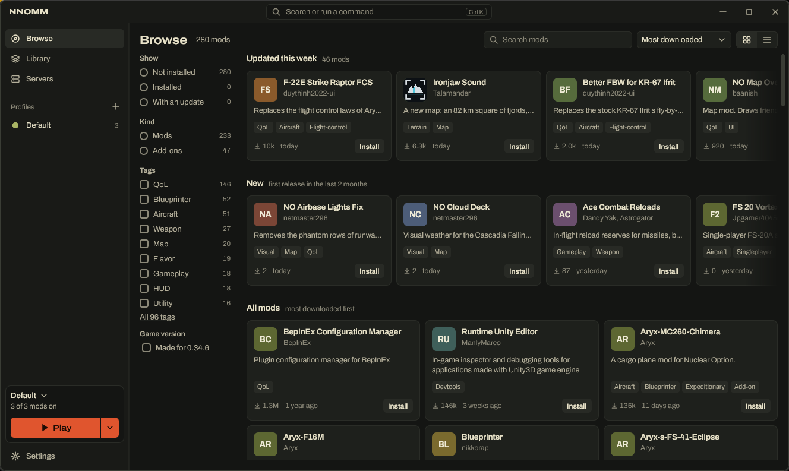
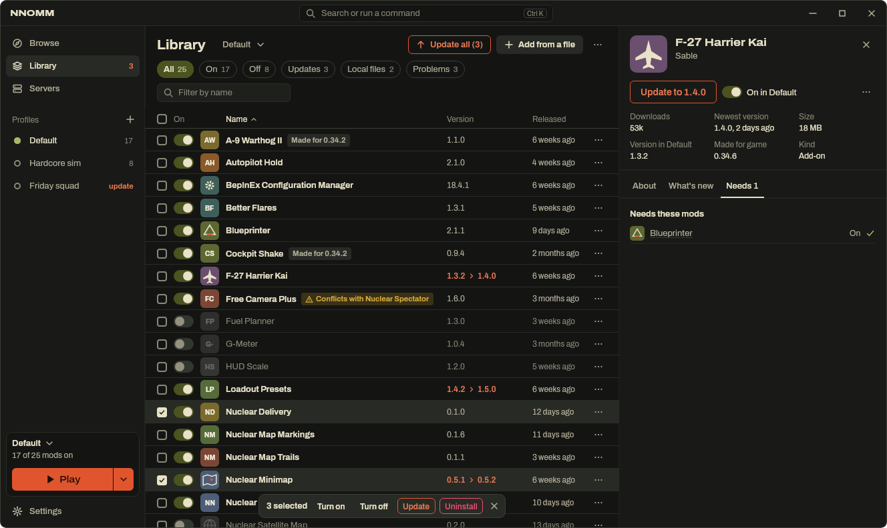

# NNOMM

**A mod manager for [Nuclear Option](https://store.steampowered.com/app/2168680/Nuclear_Option/).** Find mods, install them with one click, keep them up to date, and switch between sets of mods for different ways to play.



> [!IMPORTANT]
> **NNOMM is new and has no download yet.** No release of NNOMM exists yet. To use it now, you build it yourself (see [Get NNOMM](#get-nnomm)). It works on Windows with real mods, but one step is not tested yet: starting the game through Steam. Until that is tested, **keep a copy of your game folder** before you use NNOMM for the first time.

## What NNOMM does for you

- **Find mods.** Browse the mods of the [NOMNOM registry](https://github.com/KopterBuzz/NOMNOM) (about 280 mods). Search by name, tag, author or description. See what is new and what was updated this week.
- **Install with one click.** NNOMM downloads the mod, checks the download, and also installs the mods it needs. For example, add-on aircraft need Blueprinter, so NNOMM installs Blueprinter too.
- **Installs the mod loader for you.** Mods need the mod loader BepInEx. When you turn on your first mod, NNOMM installs BepInEx and tells you. If you already have BepInEx, NNOMM uses it as it is.
- **Keep mods up to date.** NNOMM shows which mods have an update and what changed. "Update all" updates them together. You can go back to the previous version.
- **Turn mods on and off.** One switch per mod. A mod that is off stays on your computer, so you can turn it on again without a download.
- **Profiles.** A profile is a list of mods that are on, with the version of each mod. Make one for multiplayer with your squad and one for single player, and switch between them in one click.
- **Modpacks.** Share a profile as a file. A friend opens the file, sees exactly what it contains, and gets the same mods in the same versions.
- **Find the mod that breaks the game.** A guided test turns mods off in halves until it finds the mod that causes a problem. Then you choose: keep that mod on, leave it off or remove it. All other mods are back as they were.
- **Undo.** Uninstalled a mod by mistake? Click Undo or press Ctrl Z.



*The Library with example mods: switches, a "Conflicts with" badge, three selected mods, and the panel of one mod with its update.*

## Your game is safe

- **NNOMM changes nothing in your game folder until you install, uninstall or switch a mod.**
- At the first start, NNOMM takes over the mods that are already in your game folder, as they are. You do not lose a mod.
- NNOMM never deletes your files without a copy. Mod settings that you change in the game (for example with F1) are kept. Profiles share them, or you give a profile its own mod settings.
- If your computer stops during a change, NNOMM finishes or reverses the change at the next start.
- **No Steam sign-in.** NNOMM never asks for your Steam account and runs no Steam helper program. Steam shows you as playing Nuclear Option only while the game really runs.
- While the game runs, NNOMM keeps your changes and applies them when the game closes.

## Get NNOMM

NNOMM has no release yet. When a release exists, you will find a Windows installer on the [Releases page](https://github.com/scramd/NNOMM/releases). An installed NNOMM can then look for its own updates (**Settings > About and updates > Update NNOMM**).

Until then, you can build NNOMM yourself on Windows:

1. Install [Git](https://git-scm.com/download/win) and a Java JDK, version 17 or newer (for example [Temurin](https://adoptium.net/)). The build downloads the Java version that NNOMM needs by itself.
2. Open a command prompt and run:

   ```bat
   git clone https://github.com/scramd/NNOMM.git
   cd NNOMM
   gradlew.bat :composeApp:createDistributable
   ```

   The first build downloads a lot and takes a while.
3. Start `composeApp\build\compose\binaries\main\app\NNOMM\NNOMM.exe`.

You can keep the `NNOMM` folder anywhere. To see NNOMM with example data first, without your game, start it with `--demo`:

```bat
composeApp\build\compose\binaries\main\app\NNOMM\NNOMM.exe --demo
```

**Linux:** NNOMM also runs on Linux, but it is less tested there. Choose the game folder yourself (usually `~/.local/share/Steam/steamapps/common/Nuclear Option`). For mods under Proton, put `WINEDLLOVERRIDES="winhttp.dll=n,b" %command%` in the game's launch options in Steam. See the [development guide](docs/development.md) for the build on Linux.

## Start in four steps

1. **Start NNOMM.** It looks for Nuclear Option through Steam and shows what it found: the game folder, the mods that are already there, and the mod loader. If it cannot find the game, click **Choose folder** and select the folder that contains `NuclearOption.exe`.
2. **Click Open my Library** (or **Look for mods first**). Your existing mods are now in the Library.
3. **Go to Browse and click Install** on a mod you want. The mod is on in your profile at once.
4. **Click Play.** NNOMM starts the game through Steam with the mods of your profile.

The [user guide](docs/user-guide.md) explains every page, profiles, modpacks, settings and the keyboard.

## Using NNOMM beside NOMM

NNOMM is a new version of [NOMM by Combat787](https://github.com/Combat787/NOMM), with a new interface. You can install both. NNOMM has its own settings folder and never changes NOMM's settings. NNOMM takes over the mods that NOMM installed, also the ones that NOMM turned off.

Use one mod manager at a time for a game folder. Two managers that move the same mod files can work against each other.

## Not in this version

- **Servers.** The Servers page says "Coming later". A list of dedicated servers comes in a later version.
- **Games that players host** are never listed, because that needs a Steam helper program.

## Help

- [User guide](docs/user-guide.md): every page and feature.
- [Problems and questions](docs/troubleshooting.md): a mod does not load, the game is not found, a download fails, and more.
- Asking someone for help? In NNOMM, **Settings > About and updates > Problem report > Copy report** makes a report with your mod list, the versions, NNOMM's errors and the last game log. You see the report before you copy it. It includes your game folder and messages from mods.

## For developers

How to build, test and change NNOMM: [docs/development.md](docs/development.md).

## Credits and licence

- NNOMM is a fork of [NOMM](https://github.com/Combat787/NOMM) by Combat787.
- The mod list comes from the [NOMNOM registry](https://github.com/KopterBuzz/NOMNOM) by KopterBuzz. The mods belong to their authors.
- The typeface is Archivo, under the SIL Open Font License.
- NNOMM and the NOMM code it uses are under the [MIT licence](LICENSE).

NNOMM is not made by or connected to the developers of Nuclear Option.
