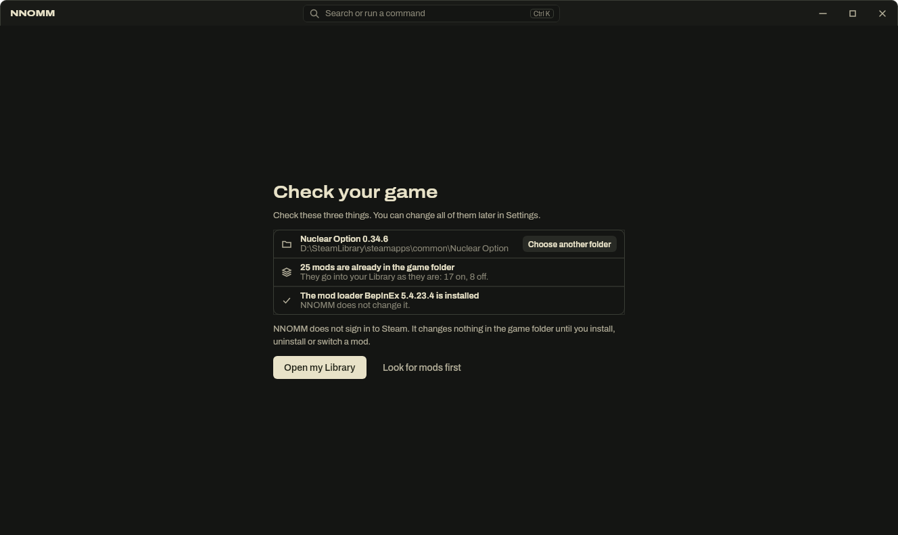
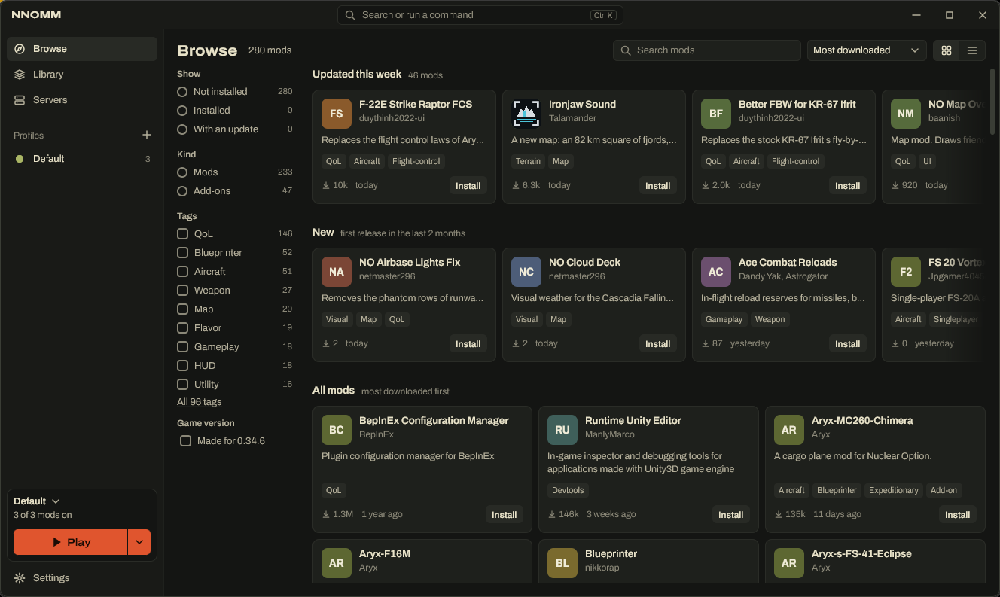
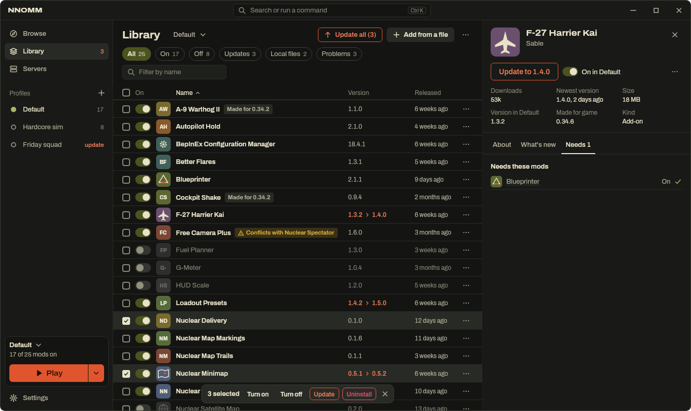
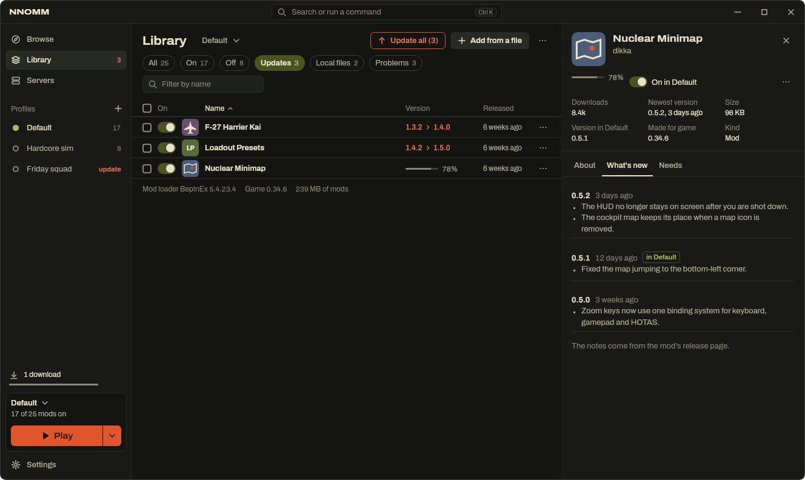
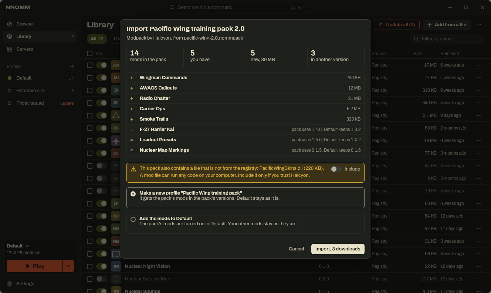
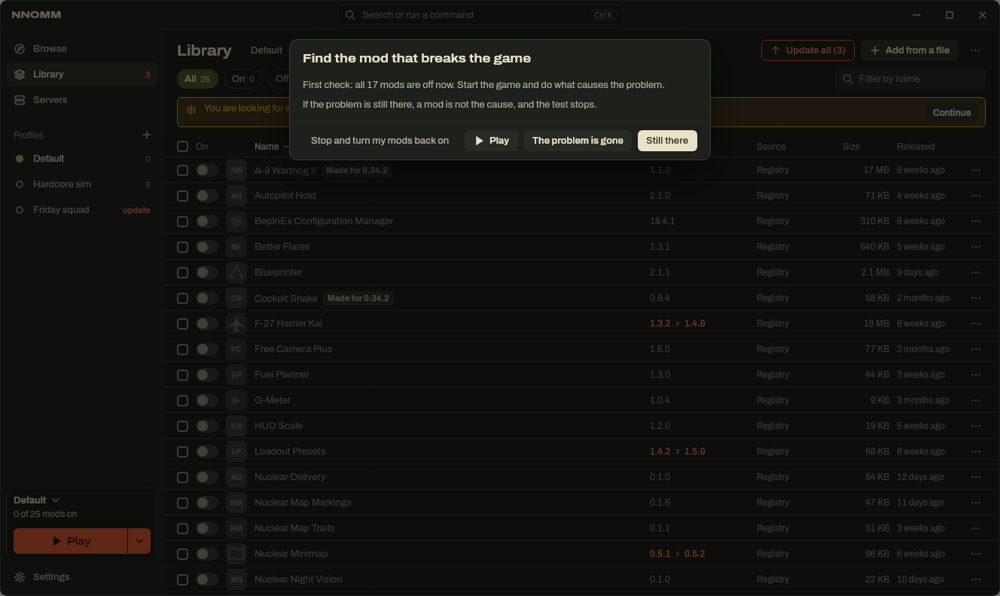

# NNOMM user guide

This guide explains every part of NNOMM, the mod manager for Nuclear Option. If you are new, read [Start in four steps](../README.md#start-in-four-steps) in the README first.

Most pictures in this guide show NNOMM with example mods. The mod names in them are invented.

**Contents**

- [Words in this guide](#words-in-this-guide)
- [The first start](#the-first-start)
- [The window](#the-window)
- [Browse: find and install mods](#browse-find-and-install-mods)
- [Library: your mods](#library-your-mods)
- [The mod panel](#the-mod-panel)
- [Updates](#updates)
- [Profiles](#profiles)
- [Modpacks](#modpacks)
- [Add a mod from a file](#add-a-mod-from-a-file)
- [Play](#play)
- [Find the mod that breaks the game](#find-the-mod-that-breaks-the-game)
- [Downloads](#downloads)
- [Undo](#undo)
- [Settings](#settings)
- [Keyboard](#keyboard)
- [Where NNOMM keeps its files](#where-nnomm-keeps-its-files)
- [Stop using NNOMM](#stop-using-nnomm)

## Words in this guide

| Word | Meaning |
| --- | --- |
| Mod | A file or folder that changes the game, for example a new aircraft or a better map. |
| Add-on | A mod that extends another mod. Every add-on needs its main mod, for example add-on aircraft need Blueprinter. |
| Registry | The online list of mods that NNOMM can install. NNOMM uses the [NOMNOM registry](https://github.com/KopterBuzz/NOMNOM). |
| Mod loader | The program that loads mods into the game. Nuclear Option uses BepInEx 5. |
| Profile | A list of mods that are on, with the version of each mod. There is always one profile that you cannot delete. At first it is called Default. |
| Modpack | A profile saved as a file (`.nommpack`) that you can give to other players. |
| Local file | A mod that you added from a file. It is not in the registry, so NNOMM cannot look for its updates. |

## The first start

At the first start NNOMM shows **Check your game** with three things:

1. **The game folder.** NNOMM looks for Nuclear Option through Steam on Windows. If the folder is wrong, or NNOMM did not find it, click **Choose another folder** (or **Choose folder**) and select the folder that contains `NuclearOption.exe`. On Linux you always choose the folder yourself.
2. **The mods that are already in the game folder.** They go into your Library as they are. Mods that are on stay on, and mods that NOMM turned off stay off.
3. **The mod loader.** If BepInEx is installed, NNOMM does not change it. If it is not installed, NNOMM installs it when a mod needs it.

Click **Open my Library** to see your mods, or **Look for mods first** to go to Browse. Nothing in the game folder changes until you install, uninstall or switch a mod.

You can change all three later in **Settings > Game**.

## The window

- **Sidebar** on the left: Browse, Library (with the number of updates), Servers, your profiles, the downloads, the Play box and Settings.
- **Search field** at the top (Ctrl K): find mods, profiles, pages, settings and actions, and run them. Type a few letters, use the arrow keys, and press Enter.
- **Mod panel** on the right: opens when you click a mod. The list behind it keeps its place and its filters.
- **Right-click** a mod, a profile or the Play button for a menu of actions.
- You can make the sidebar, the Browse filters, the mod panel and the Settings list wider or narrower: drag their inner edge. Double-click the edge to go back to the normal width.
- In a narrow window the sidebar becomes a row of icons, and the mod panel lies over the list.

## Browse: find and install mods

Browse shows every mod in the registry.

- **On top**, with the default sort: mods updated this week, new mods (first release in the last 2 months), and mods for mods you have. Below: all mods.
- **Search** looks in the name, the tags, the author and the description, and shows why a mod matched.
- **Sort** by Most downloaded, Recently updated, Newest or Name.
- **Grid or list:** the two buttons beside the sort.
- **Filters** on the left:
  - **Show:** Not installed, Installed, With an update.
  - **Kind:** Mods or Add-ons.
  - **Tags:** choose one or more tags. Choose if a mod must have any or all of them.
  - **Hide a tag:** point at a tag and click **Hide** (or move to the tag with Tab and press the minus key). Mods with that tag disappear from Browse, whatever you chose for the other tags. Hidden tags show under **Hide mods with**. Click the cross to show the mods again.
  - **Game version:** only mods made for your game version.

  Click a selected filter again to clear it. The numbers beside each filter show how many mods you get.

Each mod has one button that follows its state:

| Button | What it does |
| --- | --- |
| **Install** | Downloads the mod and the mods it needs, and turns them on in your profile. |
| **Update** | Installs the newest version. |
| **Turn on** | The mod is installed but off in this profile. Turns it on. |
| **On** | The mod is installed and on. |
| **Repair** | The mod's file is missing. Downloads it again. |

Click a mod to open [the mod panel](#the-mod-panel) with its description, its release notes and the mods it needs.

**No connection?** Browse shows the list that NNOMM saved the last time, with a notice. You cannot install until the connection is back.

## Library: your mods

The Library lists every mod on your computer, with its switch for the profile you use.

- **Switch:** turns the mod on or off in this profile. A mod that is off has a grey name.
- **Columns:** name, version, source (Registry, Modpack or Local file), size, release date. Click a column heading to sort.
- **Quick filters** on top: All, On, Off, Updates, Local files, Problems. Each shows how many mods it has.
- **Filter by name:** type to find a mod.
- **Three dots** at the end of a row (or right-click the row): open details, turn on or off, update, see what's new, open the mod folder, open its settings file, uninstall.
- **The three dots beside Add from a file:** import a modpack, share this profile as a modpack, look for updates, find the mod that breaks the game, open the mods folder.
- At the bottom, NNOMM shows the version of the mod loader, the game version and how much space your mods use.

### Select several mods

Click the box at the start of a row. Shift-click selects a range, Ctrl-click adds one mod. A bar appears with actions for all selected mods: **Turn on**, **Turn off**, **Update**, **Uninstall**. Right-click a selected row for the same actions.

### Problem badges

A badge beside a mod's name tells you about a problem. Click it for a menu of fixes.

| Badge | Meaning |
| --- | --- |
| **Needs** *a mod* | The mod needs another mod that is not on. The fix installs it or turns it on. |
| **Conflicts with** *a mod* | The authors say the two mods do not work together. Use one of them at a time. |
| **File missing** | The mod's file is missing. **Repair** downloads it again. |
| **Made for** *a game version* | The mod was made for another game version. This is only information: the mod can still work. Hover over the badge to see your game version. |
| A sentence, for example "a file could not be changed" | NNOMM could not change the mod's files in the game folder, for example because another program uses a file. Do what the message says, then **Retry**. |

The **Problems** quick filter shows the mods with a problem.

### Uninstall

**Uninstall** removes a mod from the Library and from all profiles, and takes its files out of the game folder. A message with **Undo** appears. NNOMM keeps the stored copy for a while; **Clear** in Settings removes it later. To turn a mod off only in one profile, use its switch.

## The mod panel

Click a mod in Browse or in the Library to open its panel. Press Esc to close it.

- **On top:** the main button (Install, Update and so on), the switch for your profile, and facts: downloads, newest version, size, your version, the game version the mod was made for, and the kind of mod.
- **About:** the description, a link to the mod's page on GitHub, and **On this computer**:
  - a switch for each profile,
  - **Version:** choose another version, for example to go back after an update,
  - **Open the mod folder** and **Open its settings file**,
  - **Uninstall**.
- **What's new:** the release notes from the mod's release page. Your version is marked.
- **Needs:** the mods that this mod needs, the mods that need it, and the mods it does not work together with.

## Updates

- NNOMM reads the registry when it starts (you can change this in **Settings > Mods and updates**).
- The Library shows the number of updates in the sidebar. A mod with an update shows its old and new version in orange.
- **Update all** updates every installed mod that has an update, also mods that are off in this profile. Local files and mods that a modpack controls are not included. You can also update one mod from its row, from Browse or from its panel.
- **What's new** in the mod panel shows what changed.
- NNOMM keeps the previous version (one version by default). To go back, choose it under **Version** in the mod panel.
- **Test versions:** authors mark some versions as pre-release. NNOMM offers them only if you turn on **Offer test versions of mods**.

## Profiles

A profile is a list of mods that are on, with the version of each mod. Every mod is stored only once on your computer, also when several profiles use it.

Examples: "Squad night" with the mods your squad uses on its server, "Single player" with aircraft add-ons and visual mods.

- **Make a profile:** click **+** beside Profiles in the sidebar. A new profile starts with all mods off, as a copy of the current profile, or from a modpack file.
- **Use a profile:** click it in the sidebar. NNOMM puts that profile's mods into the game folder at once (while the game runs, when it closes). The Play box shows which profile is in use and how many mods are on.
- **Right-click a profile** for: Use this profile, Play with this profile (Play for the profile in use), Rename, Make a copy, Share as a modpack, Settings for this profile, See what changes in *version* (for a modpack with an update), Stop following this pack (for a profile made from a modpack), Delete this profile. The first profile cannot be deleted, but you can rename it.
- **Mod settings for each profile:** mod settings are the values you change in the game, for example with F1. A profile can keep its own mod settings, so the same mod can have different settings in each profile. Turn this on when you make the profile, or in **Settings > Profiles**.
- **Do not need profiles?** Turn off **Show profiles in the sidebar** in **Settings > Profiles**. NNOMM then uses the Default profile, and you have one list of mods. A modpack that you import then adds its mods to Default.

## Modpacks

A modpack is a profile saved as a `.nommpack` file. Use it to give your squad the same mods in the same versions.

### Share a profile

Right-click the profile and choose **Share as a modpack** (or use the three dots in the Library). Then:

- give the pack a **name** and a **version**,
- choose if the pack includes your **mod settings** (so the pack arrives configured) and your **local files**,
- optional: an **address for updates**. If you put a newer pack file at that address later, players who imported the pack see that an update is available.

Click **Save the modpack file**, then send the file to your friends. **Copy the mod list as text** gives a plain list, for example for a chat message.

### Import a modpack

Open the `.nommpack` file, drag it onto the NNOMM window, or choose **Import a modpack**. NNOMM shows what the pack contains **before** it installs anything:

- the number of mods, how many you already have, how many are new and their download size, and which mods are in another version,
- one warning that names each mod that cannot be installed the way the pack asks, and why: the mod is not in the registry (for example, it is not released yet), the registry no longer has the pack's version, or the pack does not say which version. Such a mod is left out; if you already have it, NNOMM uses your version. The rest of the pack installs normally.
- mods that the pack contains as files, because they are not in the registry. Each has a switch, and each starts **off**. A mod file can run any code on your computer, so turn a file on only if you trust the person who made the pack. A file that you turn on is on in the imported profile.

Then choose:

- **Make a new profile** (the default): the new profile gets the pack's mods in the pack's versions. Type its name under **Profile name**; it starts as the pack's name. Your other profiles stay as they are.
- **Add the mods to** your profile: the pack's mods are turned on in that profile. Your other mods stay as they are. If your profile has a newer version of a mod than the pack, choose **Keep** your version or **Use** the pack's version.

### Pack updates

When a pack has a newer version at its address, the profile shows **update** in the sidebar. Right-click it and choose **See what changes in** *version*: NNOMM shows the mods that the update adds, removes and changes, before anything happens.

A profile made from a pack follows the pack: the pack sets the versions of its mods (the mod panel shows "set by the modpack"), and these mods get their updates through pack updates. To manage the versions yourself, right-click the profile and choose **Stop following this pack** (it is also in the pack update window). The profile keeps its mods and their versions, and you can then update them and change their versions yourself. NNOMM no longer looks for updates of the pack.

## Add a mod from a file

For a mod that is not in the registry:

- click **Add from a file** in the Library, or
- drag the file onto the NNOMM window.

NNOMM accepts `.dll`, `.zip` and `.7z` files. The mod goes into your Library. If the file is a mod from the registry, NNOMM recognises it and can update it later. Otherwise it is a local file: NNOMM cannot look for its updates, but you can use **Replace with a newer file** in its panel.

A `.nommpack` file opens the modpack preview.

## Play

Click **Play** in the sidebar (or press Ctrl Enter). NNOMM puts the mods of your profile in the game folder and starts the game through Steam. You must have Steam installed and be signed in to Steam as usual.

> [!NOTE]
> The start through Steam is not tested on Windows yet. Mods that NNOMM installs do load when the game starts. Keep a copy of your game folder the first time.

The arrow beside Play opens a menu (you can also right-click Play):

- **Play without mods:** starts the game with the mod loader turned off for this start. Your mods stay as they are.
- **Open the game folder.**
- **Open the mod log:** messages from mods, useful when a mod fails.

**While the game runs**, NNOMM shows "Game is running". You can still change mods; NNOMM applies the changes when the game closes. To close the game from NNOMM, right-click "Game is running" and choose **Stop the game**, as with Stop in Steam.

**Start options** for the game (for example `-screen-fullscreen 0`) and what NNOMM does when the game starts (stay open, minimise, close) are in **Settings > Game**.

## Find the mod that breaks the game

Something is wrong in the game, and you do not know which mod causes it? In the Library, click the three dots and choose **Find the mod that breaks the game**.

1. NNOMM turns all mods off. Start the game and do what causes the problem.
2. Tell NNOMM the result: **The problem is gone** or **Still there**. If the problem is still there with all mods off, a mod is not the cause, and the test stops.
3. NNOMM turns half of the mods on and asks again. Mods always stay together with the mods they need.
4. After a few rounds NNOMM names the mod that causes the problem. Choose **Keep it on**, **Leave it off** or **Remove it**. All other mods are back as before the test.

When you click **Stop and turn my mods back on**, your profile is exactly as before the test.

The test assumes that one mod causes the problem. If two mods cause it only together, the result can be "inconclusive".

## Downloads

Downloads appear in the sidebar above the Play box. They never block the window: you can continue to use NNOMM.

- A failed download shows **Failed**, with two small buttons: **Try again** (the circle arrow) and **Remove from the list** (the cross).
- The cross beside a running download cancels it.
- NNOMM checks each download from the registry before it uses it.

## Undo

Actions that you can reverse show a message with **Undo** for a few seconds, for example an uninstall. Ctrl Z undoes the newest one. That is why NNOMM does not ask "Are you sure?" for them. It asks only for the danger zone of Settings and before it saves a modpack over an existing file.

## Settings

Click **Settings** at the bottom of the sidebar (or press Ctrl ,). Use the search at the top to find a setting.

**All profiles or one profile:** some settings can differ for each profile, for example the start options. Choose a profile at the top: you then see only those settings. Click **Change for this profile** to give the profile its own value, and **Use the general setting** to go back.

| Group | Settings |
| --- | --- |
| **Game** | Game folder (Find again, Choose folder). Start options. When the game starts: keep NNOMM open, minimise it or close it. Mod loader (Repair). Show the mod log window while the game runs. |
| **Mods and updates** | When NNOMM reads the registry for new mods and updates. Tell me about updates, or update by itself. Offer test versions of mods. How many old versions to keep after an update. Install mods that a mod needs. Mark mods made for an older game version. |
| **Profiles** | Show profiles in the sidebar. New profiles keep their own mod settings. A new profile starts with all mods off or as a copy. |
| **Registry** | The addresses NNOMM reads mods from. Hide mods that are only for servers. |
| **Servers** | Show Servers in the sidebar. |
| **Storage** | Where NNOMM keeps mod files (Move, Open). Downloaded files that are no longer in use (Clear). |
| **Appearance** | Theme (same as Windows, dark, light). Row height in lists. Text size. Animations. **Leave out "Nuclear" in mod letters**: mods without a picture show two letters from their name, and this leaves out a first word "Nuclear". The page NNOMM opens on. |
| **Keyboard** | The list of keys (see [Keyboard](#keyboard)). |
| **About and updates** | Update NNOMM. Get test versions of NNOMM. Problem report (Copy report, Open log folder). Licences. |
| **Danger zone** | Reset all NNOMM settings. Remove all mods. Both ask for confirmation. |

**Clear** removes stored mod versions that no profile uses, and recovery copies that are no longer needed. It keeps the number of old versions you chose, and the last copy of every file that cannot be downloaded again. It does not work while the game runs.

## Keyboard

| Key | Action |
| --- | --- |
| Ctrl K | Search or run a command |
| Ctrl Enter | Start the game |
| / | Find on this page |
| Up, Down | Move in a list |
| Space | Turn the mod on or off |
| Enter | Open details |
| Shift click | Select a range |
| Ctrl A | Select all |
| Delete | Remove the selected mods |
| Ctrl Z | Undo |
| Esc | Close a panel or window |
| Ctrl 1, 2, 3 | Browse, Library, Servers |
| Ctrl , | Settings |

Tab moves between controls everywhere.

## Where NNOMM keeps its files

| What | Where |
| --- | --- |
| Settings, profiles and the mod store | `%APPDATA%\NNOMM` on Windows. On Linux `~/.config/NNOMM`, or `$XDG_CONFIG_HOME/NNOMM` when that is set. |
| Every version of every mod, stored once | The `mods` folder in the settings folder. You can move it: **Settings > Storage**. |
| Mods that are on in the profile in use | `BepInEx\plugins` in the game folder |
| What NNOMM placed in the game folder | `BepInEx\plugins\.nnomm-state.json`. NNOMM never touches files it did not place or take over. |

NNOMM never uses NOMM's settings folder.

## Stop using NNOMM

- **To remove all mods from the game:** **Settings > Danger zone > Remove all mods**. Every mod leaves the Library, every profile and the game folder, and NNOMM removes the loader files that it installed itself. Your settings and profiles stay, and so do game files, mod settings and logs. To remove only some mods, select them in the Library and click **Uninstall**.
- **To play without mods once:** use **Play without mods** in the Play menu.
- **To remove NNOMM:** first remove the mods as above if you want a clean game folder, then uninstall NNOMM. Your settings folder stays; delete it by hand if you do not need it.
